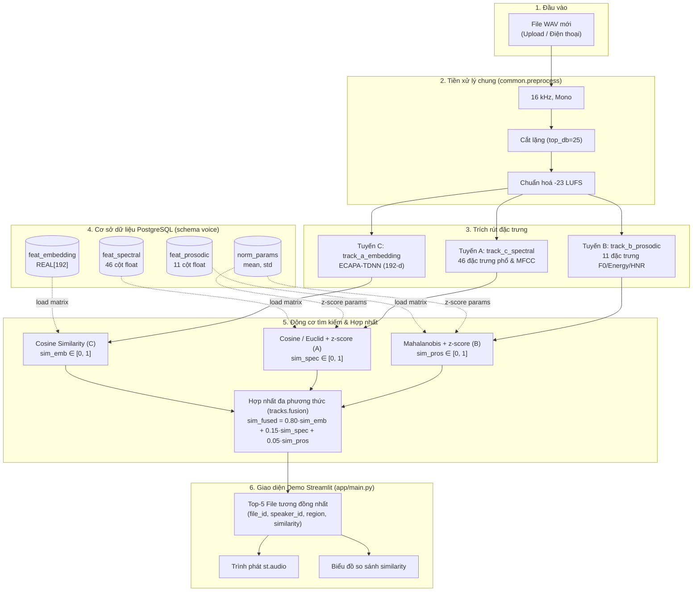
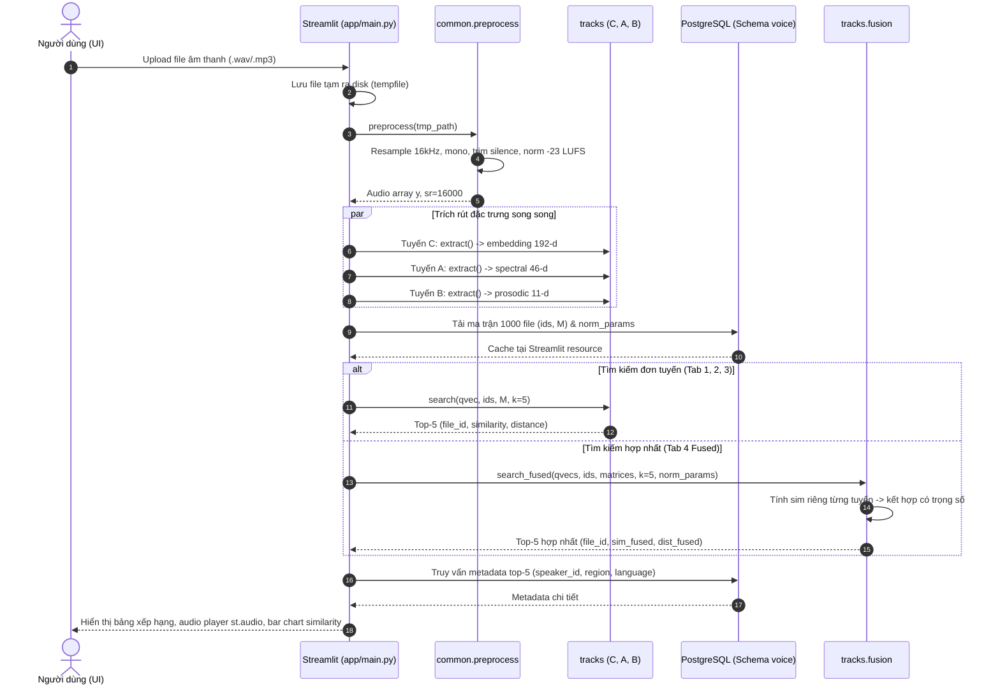

# Báo cáo Giai đoạn 2B (Thành viên C) — Sơ đồ khối & Quy trình truy vấn (Yêu cầu 4a)

> Tài liệu này do **Thành viên C** phụ trách theo phân công Giai đoạn 2B: trình bày **sơ đồ khối hệ thống**, **mô tả cấu trúc các module**, và **quy trình truy vấn end-to-end** kết nối 3 tuyến đặc trưng.

---

## 1. Sơ đồ khối tổng thể hệ thống

Hệ thống tìm kiếm giọng nói hoạt động qua 5 phân tầng chức năng:
1. **Tầng nhập liệu**: Nhận file âm thanh truy vấn (file WAV upload qua giao diện hoặc file thu âm điện thoại).
2. **Tầng tiền xử lý**: Chuẩn hóa chuẩn chung (16 kHz, mono, cắt khoảng lặng `top_db=25`, chuẩn hóa âm lượng `-23 LUFS`).
3. **Tầng trích rút đặc trưng**: Trích rút song song 3 bộ đặc trưng (Tuyến C: Embedding 192 chiều, Tuyến A: Phổ 46 chiều, Tuyến B: Prosodic 11 chiều).
4. **Tầng cơ sở dữ liệu & Tìm kiếm**: PostgreSQL 16 schema `voice` cung cấp ma trận đặc trưng 1.000 file; thực hiện tính điểm tương đồng (Cosine, Mahalanobis, Euclid có z-score).
5. **Tầng hợp nhất & Trình bày**: Hợp nhất điểm 3 tuyến theo trọng số tối ưu (`tracks.fusion`), trả về top-5 kết quả kèm phát âm thanh và biểu đồ trên Streamlit.

### Sơ đồ luồng dữ liệu (Mermaid)

---

## 2. Mô tả các module hệ thống

Toàn bộ hệ thống được module hóa theo hợp đồng chung chốt ở Bước 0, đảm bảo tính độc lập và khả năng ghép nối không xung đột:

### 2.1 Các module dùng chung (`common/`)

| Module | Hàm chính | Vai trò kỹ thuật |
|---|---|---|
| [`common.preprocess`](file:///e:/study/BT/csdl/voice_search/common/preprocess.py) | `preprocess(wav_path)` | Đọc file âm thanh bất kỳ, chuyển về mono 16 kHz, cắt bỏ lặng hai đầu (`librosa.effects.trim` với `top_db=25`), chuẩn hóa âm lượng theo chuẩn phát thanh quốc tế `-23 LUFS` qua `pyloudnorm`. Trả về `(y, sr)`. |
| [`common.db`](file:///e:/study/BT/csdl/voice_search/common/db.py) | `connect()`, `load_matrix()`, `save_embedding()`, `load_norm_params()` | Quản lý kết nối PostgreSQL (schema `voice`), tải ma trận đặc trưng `(ids, M)` từ các bảng, đọc/ghi tham số z-score (`norm_params`). Riêng tuyến embedding chặn z-score qua `ValueError`. |
| [`common.evaluate`](file:///e:/study/BT/csdl/voice_search/common/evaluate.py) | `evaluate()`, `summarize()` | Khung đo lường độc lập cho 50 truy vấn cố định (`data/query_set.csv`). Hỗ trợ split `dev` và `test`. Tách riêng đánh giá `seen` (Top-1, P@5, MAP@5) và `unseen` (`group@5`, `lang@5`). |

### 2.2 Các module trích rút đặc trưng (`tracks/`)

Mỗi module tuyến tuân thủ đúng 3 interface chuẩn:
- `extract(wav_path) -> np.ndarray`: Nhận đường dẫn file mới, bắt buộc chạy qua `preprocess()`, trả về vector đặc trưng 1 chiều.
- `load_matrix(conn) -> (ids, M)`: Tải toàn bộ ma trận 1.000 file từ bảng CSDL tương ứng.
- `search(qvec, ids, M, k=5) -> [(file_id, similarity, distance), ...]`: Trả về top-k kết quả sắp xếp **giảm dần** theo `similarity ∈ [0, 1]`.

| Tuyến | File module | Số chiều & Bản chất | Độ đo tối ưu |
|---|---|---|---|
| **C (Embedding)** | [`tracks/track_a_embedding.py`](file:///e:/study/BT/csdl/voice_search/tracks/track_a_embedding.py) | 192 chiều (`REAL[]`), mô hình ECAPA-TDNN (SpeechBrain pretrained trên VoxCeleb). Đại diện danh tính người nói (*speaker identity*). | **Cosine Similarity** (L2-normalize trực tiếp, không dùng z-score). |
| **A (Spectral)** | [`tracks/track_c_spectral.py`](file:///e:/study/BT/csdl/voice_search/tracks/track_c_spectral.py) | 46 chiều: 26 MFCC (13 mean + 13 std), centroid, bandwidth, rolloff, flatness, contrast, tonality, ZCR. Đại diện đặc tính cấu âm và phổ âm thanh. | **Cosine Similarity + z-score** (dùng `norm_params`). |
| **B (Prosodic)** | [`tracks/track_b_prosodic.py`](file:///e:/study/BT/csdl/voice_search/tracks/track_b_prosodic.py) | 11 chiều: F0 (mean, std, min, max), Intensity (mean, std), speaking rate, jitter, shimmer, HNR, ZCR. Đại diện ngữ điệu, cao độ và chất lượng dây thanh. | **Mahalanobis Distance + z-score** (khử tương quan chéo giữa các đại lượng F0 và chất giọng). |

### 2.3 Module hợp nhất đa phương thức (`tracks.fusion`)

Module [`tracks/fusion.py`](file:///e:/study/BT/csdl/voice_search/tracks/fusion.py) là hạt nhân tích hợp ở Giai đoạn 2B:
- Nhận vector truy vấn và ma trận CSDL từ cả 3 tuyến (`embedding`, `spectral`, `prosodic`).
- Chuyển đổi điểm tương đồng của từng tuyến về đoạn $[0, 1]$.
- Kết hợp tuyến tính có trọng số:
  $$\text{sim}_{\text{fused}} = w_{\text{emb}} \cdot \text{sim}_{\text{emb}} + w_{\text{spec}} \cdot \text{sim}_{\text{spec}} + w_{\text{pros}} \cdot \text{sim}_{\text{pros}}$$
- Bộ trọng số tối ưu qua grid search trên tập `dev`: $w_{\text{emb}} = 0.80$, $w_{\text{spec}} = 0.15$, $w_{\text{pros}} = 0.05$.
- Bù trừ ưu/nhược điểm: Embedding giữ vai trò trụ cột nhận diện danh tính người nói (Seen Top-1 = 1.0); Spectral và Prosodic bù đắp đặc trưng ngữ âm/accent cho các trường hợp Unseen (nâng `group@5` từ 0.82 lên 0.96 trên tập `test`).

---

## 3. Quy trình truy vấn chi tiết (End-to-End Workflow)

Quy trình truy vấn một file âm thanh mới qua hệ sinh thái Voice Search diễn ra tuần tự qua các bước:

### Các bước xử lý cụ thể:
1. **Tiếp nhận file:** Người dùng tải file lên Streamlit (`st.file_uploader`) hoặc chọn một file mẫu trong kho 1.000 file. File upload được ghi tạm ra disk để các thư viện `soundfile`/`librosa` đọc thống nhất.
2. **Tiền xử lý chuẩn hoá:** Gọi `common.preprocess.preprocess()`. Đảm bảo file mới triệt tiêu sai lệch về tần số lấy mẫu (16 kHz), số kênh (mono) và mức âm lượng (-23 LUFS), loại bỏ khoảng lặng đầu/cuối có thể làm sai lệch thống kê F0 và ZCR.
3. **Trích đặc trưng đa tuyến:**
   - Vector 192 chiều từ mạng nơ-ron ECAPA-TDNN.
   - Vector 46 chiều các thông số phổ và biến thiên năng lượng.
   - Vector 11 chiều các thông số tần số cơ bản F0, Jitter, Shimmer, HNR.
4. **Truy vấn CSDL & Chuẩn hoá thang đo:** Ma trận 1.000 file được đọc từ CSDL PostgreSQL (lưu cache bằng `@st.cache_resource`). Các vector phổ và prosodic được chuẩn hoá z-score dựa trên bảng `norm_params`; vector embedding được L2-normalize.
5. **Tính khoảng cách & Hợp nhất:** Điểm số các tuyến được tính độc lập và ánh xạ về $[0, 1]$. Hàm `search_fused` tổng hợp theo trọng số $\{0.80, 0.15, 0.05\}$, sắp xếp chọn 5 file có độ tương đồng cao nhất.
6. **Kết xuất giao diện:** Ghép nối `metadata_master` để hiển thị đầy đủ `speaker_id`, `region_accent`, `language`, kích hoạt trình nghe âm thanh gốc qua `st.audio` và vẽ đồ thị thanh so sánh độ tương đồng.
