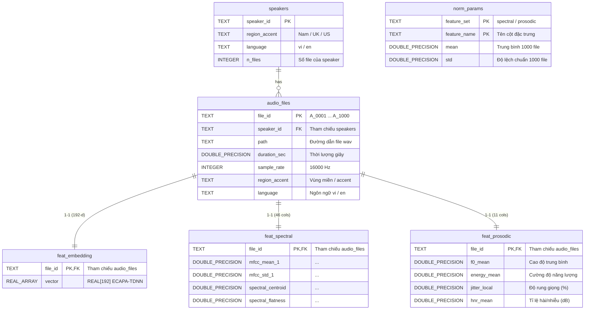

# Báo cáo Giai đoạn 2B (Thành viên C) — Cơ sở dữ liệu chung (Yêu cầu 3)

> Tài liệu này do **Thành viên C** phụ trách theo phân công Giai đoạn 2B: trình bày **thiết kế CSDL quan hệ**, **mô tả cấu trúc các bảng đặc trưng**, **quy trình tích hợp 3 tuyến**, và **kết quả kiểm tra toàn vẹn dữ liệu** trên hệ quản trị PostgreSQL 16.

---

## 1. Tổng quan thiết kế CSDL

Hệ thống lưu trữ trên **PostgreSQL 16**, đóng gói qua Docker (`docker-compose.yml`), cô lập hoàn toàn trong schema `voice` (không xung đột với schema mặc định `public`).

### 1.1 Sơ đồ thực thể liên kết (Entity-Relationship Diagram)



---

## 2. Chi tiết các bảng trong Schema `voice`

### 2.1 Bảng siêu dữ liệu: `speakers` và `audio_files`
- **`speakers` (84 dòng):** Lưu thông tin người nói gồm định danh (`speaker_id`), vùng miền/accent (`Nam`, `UK`, `US`), ngôn ngữ (`vi`, `en`) và số lượng file mẫu sở hữu (`n_files`).
- **`audio_files` (1.000 dòng):** Lưu thông tin kỹ thuật của từng tệp âm thanh gồm khóa chính `file_id` (`A_0001` đến `A_1000`), khóa ngoại liên kết `speakers(speaker_id)`, thời lượng `duration_sec`, tần số mẫu `sample_rate` (16.000 Hz), và chỉ mục tối ưu hóa truy vấn `idx_audio_speaker`.

### 2.2 Ba bảng đặc trưng của 3 tuyến
1. **`feat_embedding` (Tuyến C — 1.000 dòng):**
   - Cột `file_id` (PK, FK).
   - Cột `vector` kiểu mảng số thực native của PostgreSQL: `REAL[]` đúng 192 phần tử.
   - Ưu điểm: Lưu trữ gọn gàng 1 vector trong 1 trường duy nhất, không cần cài đặt thêm extension bên ngoài (`pgvector`), truy vấn và load ma trận `(1000, 192)` trong < 50 ms.
2. **`feat_spectral` (Tuyến A — 1.000 dòng):**
   - Cột `file_id` (PK, FK) cùng 46 cột số thực (`DOUBLE PRECISION`): 26 cột MFCC (13 mean + 13 std), và 20 cột tham số hình bao phổ (centroid, bandwidth, contrast, flatness, rolloff, tonality, zcr).
3. **`feat_prosodic` (Tuyến B — 1.000 dòng):**
   - Cột `file_id` (PK, FK) cùng 11 cột số thực: `f0_mean`, `f0_std`, `f0_min`, `f0_max`, `energy_mean`, `energy_std`, `speaking_rate`, `jitter_local`, `shimmer_local`, `hnr_mean`, `zcr_mean`.
4. **`norm_params` (57 dòng):**
   - Lưu trữ cặp tham số $(mean, std)$ được tính toán trên toàn bộ 1.000 file mẫu để phục vụ chuẩn hoá z-score lúc truy vấn.
   - Gồm 46 dòng cho `spectral` và 11 dòng cho `prosodic`. Tuyến `embedding` không lưu tại đây vì sử dụng độ đo Cosine (tự chuẩn hoá chuẩn L2).

---

## 3. Quy trình ghép 3 bảng CSDL chung ở Giai đoạn 2B

Nhóm sử dụng cơ chế xuất/nhập độc lập đảm bảo không xung đột dữ liệu:
1. **Xuất bảng từ máy thành viên:**
   - Tuyến B xuất: `pg_dump --data-only -t voice.feat_prosodic -t voice.norm_params > b_prosodic.sql`
   - Tuyến A xuất: `pg_dump --data-only -t voice.feat_spectral -t voice.norm_params > a_spectral.sql`
2. **Nạp và hợp nhất trên CSDL máy C:**
   - Thành viên C chạy nạp vào CSDL chung qua `psql` hoặc qua các script nạp chuẩn hóa (`tracks/load_t2_embedding.py`, `tracks/load_t2_spectral.py`, `tracks/load_prosodic.py`).
   - Kỹ thuật nạp dùng `psycopg2.extras.execute_values` theo khối 100 dòng, cơ chế `ON CONFLICT (file_id) DO UPDATE` giúp nạp an toàn, có thể chạy lặp lại mà không gây trùng lặp khóa chính.

---

## 4. Nghiệm thu tính toàn vẹn CSDL (Integrity Check)

### 4.1 Số lượng dòng dữ liệu
Thực thi câu SQL kiểm đếm:
```sql
SELECT 'speakers' AS bang, COUNT(*) AS so_dong FROM voice.speakers
UNION ALL SELECT 'audio_files', COUNT(*) FROM voice.audio_files
UNION ALL SELECT 'feat_embedding', COUNT(*) FROM voice.feat_embedding
UNION ALL SELECT 'feat_spectral', COUNT(*) FROM voice.feat_spectral
UNION ALL SELECT 'feat_prosodic', COUNT(*) FROM voice.feat_prosodic
UNION ALL SELECT 'norm_params', COUNT(*) FROM voice.norm_params;
```

**Kết quả kiểm tra thực tế:**

| Tên bảng | Số dòng thực tế | Số dòng chuẩn theo yêu cầu | Tình trạng |
|---|---:|---:|:---:|
| `speakers` | 84 | 84 | Đạt |
| `audio_files` | 1.000 | 1.000 | Đạt |
| `feat_embedding` | 1.000 | 1.000 | Đạt |
| `feat_spectral` | 1.000 | 1.000 | Đạt |
| `feat_prosodic` | 1.000 | 1.000 | Đạt |
| `norm_params` | 57 | 57 (46 spec + 11 pros) | Đạt |

### 4.2 Kiểm tra tính nhất quán liên bảng (Câu 6 trong `sql/examples.sql`)
Thực thi kiểm tra xem có bất kỳ file nào trong 1.000 file bị thiếu đặc trưng ở 1 trong 3 bảng hay không:
```sql
SELECT a.file_id 
FROM voice.audio_files a
LEFT JOIN voice.feat_prosodic p USING (file_id)
LEFT JOIN voice.feat_spectral s USING (file_id)
LEFT JOIN voice.feat_embedding e USING (file_id)
WHERE p.file_id IS NULL OR s.file_id IS NULL OR e.file_id IS NULL;
```
**Kết quả:** `0 dòng`. Toàn bộ 1.000 tệp âm thanh đều sở hữu đầy đủ 3 bộ đặc trưng đại diện, sẵn sàng cho công tác tìm kiếm đơn tuyến và hợp nhất đa phương thức ở Giai đoạn 2B.

### 4.3 Thống kê đặc trưng CSDL theo nhóm giọng nói
Truy vấn phân bổ F0 trung bình và số lượng file theo 3 vùng/accent trong CSDL:
```sql
SELECT a.region_accent, COUNT(*) AS so_file, ROUND(AVG(p.f0_mean)::numeric, 2) AS f0_trung_binh_hz
FROM voice.audio_files a 
JOIN voice.feat_prosodic p USING (file_id)
GROUP BY a.region_accent 
ORDER BY f0_trung_binh_hz;
```

| Vùng / Accent | Số file mẫu | Tỉ lệ (%) | F0 trung bình (Hz) | Nhận xét đặc trưng |
|---|---:|---:|---:|---|
| **UK (VCTK)** | 333 | 33.3% | 112.66 Hz | Giọng trầm, biến thiên cao độ vừa phải |
| **US (TIMIT)** | 300 | 30.0% | 118.10 Hz | Giọng tương đối phẳng, ngữ điệu đồng đều |
| **Nam (VIVOS)** | 367 | 36.7% | 144.31 Hz | Tiếng Việt có thanh điệu, cao độ F0 trung bình cao hơn rõ rệt |
